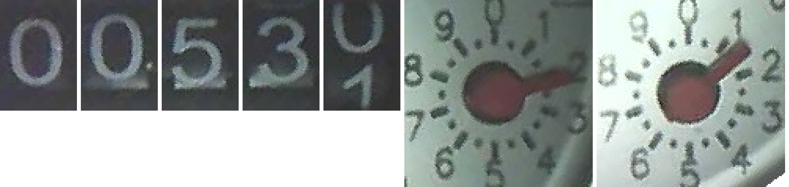
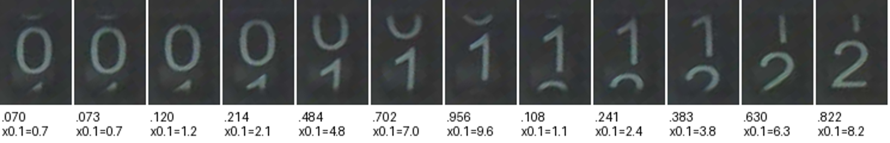

# CV node hardware run, 2026-10-13

Bench run of the CV node on an ESP32-C3 SuperMini against an ESP32-CAM running
AI-on-the-edge-device in demo mode. It checks the readiness probe and the
export flow added in `cd65404`, and how accurately readings come through on
real hardware. There is no physical meter: the camera replays the project's
12 demo photos of a water meter, whose file names are the true readings.

| | |
|---|---|
| Date | 2026-10-13, 21:29 to 21:52 (laptop time, AEST) |
| Run by | Adyn Sydee, with Claude Code driving the serial session |
| Firmware | `end_node` built from `cd65404`, flashed to the C3 over `/dev/ttyACM0` |
| End node | ESP32-C3 SuperMini, CV node (boot key `3`), channel 1, AP `AMR_Base` |
| Camera | ESP32-CAM on an ESP32-CAM-MB (`/dev/ttyUSB0`), AI-on-the-edge-device development build `fix/json-null-deref-before-flow-init` (commit `204547b+`), static IP `192.168.4.2`, `Demo = true`, one round per minute |
| Substation, gateway | Not connected. Every ESP-NOW send fails with `No substation beacon heard`, as expected |
| Serial capture | `c3_serial_2026-10-13.log`, every line stamped with laptop time |

## Results

| Run | Checks | Result | Log lines |
|---|---|---|---|
| R1 Cold boot, camera not yet on the AP | Node skips the request while no station has joined, declares itself ready only once the probe passes, then reads | Pass | 2 to 15 |
| R2 Camera reboots mid run | Failed requests send nothing, the node recovers without a restart once the camera answers again | Pass | 37 to 41 |
| R3 Full demo cycle | 12 images read in order and forwarded unchanged (accuracy below) | Pass, forwarding. Recognition 7/12 within ±0.012 | 41 to 112 |
| R4 Wrong `cam_flow` | Probe fails every 5 s, node never ready, nothing sent | Pass | 113 to 149 |
| R5 `cam_flow_exp` set | Probe passes, export is read and sent beside import | Pass | 150 to 190 |
| R6 Missing `cam_flow_exp` flow | Probe fails every 5 s, node never ready | Pass | 191 to 229 |
| R7 Sequence number across reboots | `seq` resumes from NVS after each reboot (32 → 33, 35 → 36), never repeats | Pass | 179 to 182, 257 to 260 |
| R8 Back to defaults | `cam_flow_exp` cleared, node ready again and reading import only | Pass | 230 to 265 |

### R1 Cold boot readiness

The camera had been running and searching for an AP. The C3 brought up
`AMR_Base`, the camera joined within 8 s, and the next probe passed:

```text
21:29:25.900  [WifiRadio] AP started
21:29:28.923  [CFG] seq = 0 (NVS)
21:29:28.923  [HttpBus] No station joined the AP yet, skipping request.
21:29:34.263  [CV] Cam answered with every configured flow, node ready.
21:29:34.667  [CV] import=0.480 export=0.000 seq=1
21:29:37.588  [Link] No substation beacon heard
21:29:37.589  [CV] ESP-NOW send failed.
```

The camera config at that point only had one digit and one dial window, hence
`0.480`. R3 onwards uses the full demo config, see [Camera setup](#camera-setup).

### R2 Camera reboot

The camera was rebooted at 21:33:16 to load the demo config. The node rode it
out with no intervention, rejecting the empty value the camera serves before
its first round:

```text
21:33:34.448  [HttpBus] GET http://192.168.4.2/json failed, HTTP status -1
21:34:04.590  [Cam HTTP Reader] Flow "main" has no value yet.
21:34:34.422  [Cam HTTP Reader] Flow "main" has no value yet.
21:35:04.550  [CV] import=530.074 export=0.000 seq=9
```

### R3 Demo cycle and accuracy

The C3 polls every 30 s and the camera finishes a round every 60 s, so each
camera value appears in two readings. One value per round, against the demo
image the camera was on (`accuracy.csv`):

| C3 time | seq | Camera value | True value | Error |
|---|---|---|---|---|
| 21:35:04 | 9 | 530.074 | 530.07325 | +0.001 |
| 21:36:04 | 11 | 530.112 | 530.12067 | −0.009 |
| 21:37:04 | 13 | 530.115 | 530.21419 | −0.099 |
| 21:38:04 | 15 | 530.478 | 530.48435 | −0.006 |
| 21:39:04 | 17 | 530.715 | 530.70265 | +0.012 |
| 21:40:04 | 19 | 531.757 | 530.95675 | +0.800 |
| 21:41:04 | 21 | 531.111 | 531.10877 | +0.002 |
| 21:42:04 | 23 | 531.151 | 531.24108 | −0.090 |
| 21:43:04 | 25 | 531.475 | 531.38301 | +0.092 |
| 21:44:04 | 27 | 531.641 | 531.63071 | +0.010 |
| 21:45:04 | 29 | 532.711 | 531.82235 | +0.889 |
| 21:46:04 | 31 | 530.071 | 530.07077 | +0.000 |

The images are taken in `files.txt` order, one per round. The first value
lines up with the second image, and the cycle wraps back to the first image
(530.07077) exactly 12 rounds later, which confirms the alignment.

- **7 of 12** are within ±0.012.
- **3 of 12** are about 0.1 out: the camera read the ×0.1 dial one division off.
- **2 of 12** are about 0.8 to 0.9 out: the last digit wheel was mid roll, and
  with the ×0.1 dial also misread, the camera picked the next whole number.

These are recognition errors in the camera. The firmware forwards exactly what
the camera reports. A snapshot of the camera at 21:36:49 shows its JSON saying
`530.11512` (`camera/json_213649.json`), and the C3 logged `530.115` for that
round at 21:37:04. The same snapshot's processed image is the "After" image
below: the demo photo for 530.21419, where the ×0.1 dial needle is just past 2
but the camera read it as 1. The
digit and dial windows were placed by hand from one frame (below) and have not
been fine tuned. Every large error involves the ×0.1 dial. The cause turned
out to be the camera's dial model, not the windows, see
[Tuning](#tuning-2026-10-14).

### R4 to R6 Probe failures and the export flow

```text
21:47:30.817  [CFG] cam_flow = wrong (NVS)
21:47:33.841  [HttpBus] No station joined the AP yet, skipping request.
21:47:39.078  [Cam HTTP Reader] Flow "wrong" not present in response.
21:47:44.115  [Cam HTTP Reader] Flow "wrong" not present in response.
...                                                      (every 5 s, no readings)

21:48:35.506  [CFG] cam_flow_exp = main (NVS)
21:48:43.771  [CV] Cam answered with every configured flow, node ready.
21:48:54.052  [CV] import=530.115 export=530.115 seq=33

21:50:34.611  [CFG] cam_flow_exp = export (NVS)
21:50:42.873  [Cam HTTP Reader] Flow "export" not present in response.
...                                                      (every 5 s, no readings)
```

The camera only has one number, `main`, so R5 points `cam_flow_exp` at that
same number. That proves the export request, parse and payload path, with
export equal to import. It is not evidence that the camera can read a real
export register, which needs a meter showing both registers in one frame.

## Camera setup

The camera already had `Demo = true` and the 12 demo images in `/demo`, but
`config.ini` had only one digit window (`main.dig1`, the last wheel) and one
dial window (`main.ana1`, ×0.1). Its reading was the last digit plus decimals,
`1.77` instead of about 530. To compare against the true values, the config
was changed to read all five wheels and all four dials:

```diff
-main.dig1 438 62 49 71 false
+main.dig1 197 62 49 71 false
+main.dig2 258 62 49 71 false
+main.dig3 320 62 49 71 false
+main.dig4 375 62 49 71 false
+main.dig5 438 62 49 71 false
 ...
 main.ana1 452 199 120 120 false
+main.ana2 362 307 120 120 false
+main.ana3 217 330 120 120 false
+main.ana4 87 252 120 120 false
```

The original is kept as `camera/config.ini.before`, the uploaded one as
`camera/config.ini.demo`. The upload was read back and compared before the
camera was rebooted.

| Before: one digit and one dial window | Windows planned on the aligned image | After: all nine windows. Camera read 530.11512, true value 530.21419 |
|---|---|---|
|  |  |  |

## Tuning, 2026-10-14

The errors in R3 were traced and fixed on the camera, with no firmware change.
After tuning, all 12 demo images read within ±0.005 (`accuracy_tuned.csv`):

| True value | Before | After |
|---|---|---|
| 530.07077 | (not captured) | 530.071 |
| 530.07325 | 530.074 | 530.074 |
| 530.12067 | 530.112 | 530.122 |
| 530.21419 | 530.115 | 530.214 |
| 530.48435 | 530.478 | 530.489 |
| 530.70265 | 530.715 | 530.704 |
| 530.95675 | 531.757 | 530.957 |
| 531.10877 | 531.111 | 531.111 |
| 531.24108 | 531.151 | 531.241 |
| 531.38301 | 531.475 | 531.383 |
| 531.63071 | 531.641 | 531.631 |
| 531.82235 | 532.711 | 531.822 |

The 530.07077 reading is from the first tuned cycle (`AnalogToDigitTransitionStart`
not yet set, which does not affect a ×0.1 value of 0.7). The rest are from the
final config (`c3_serial_2026-10-14_tuning.log`). Final config:
`camera/config.ini.tuned`.

### How it was found

To test changes without waiting a 12 minute cycle for each one, the camera's
pipeline was rebuilt on the laptop: its alignment (InitialRotate, then the two
reference marks), the same window crops, and its own `.tflite` models run with
LiteRT. The rebuilt alignment matched the camera's own aligned frames to within
3 to 4 grey levels, and the rebuilt readings reproduced the camera's (for
example 530.1151 for the 530.21419 image, against the camera's 530.11512).

### Cause 1: the dial model clips its output

The configured dial model, `ana-cont_1400_s2_q.tflite`, outputs the sine and
cosine of the needle angle, quantised to int8 with a range of −0.98 to
**+0.057**. Neither output can go positive, so it only reads needles between 5
and 7.5 correctly. Between 0 and 2.5 it always returns 1.25, and above or
below that band the angle is squashed towards 4.9 or 7.6. That is why 2.14
read as 1, and 9.57 as 7.

Scored over all 12 images, mean error in dial divisions (×0.1 dial, ×0.01 dial):

| Model on the camera's SD card | ×0.1 | ×0.01 |
|---|---|---|
| `ana-cont_1400_s2_q.tflite` (was configured) | 0.59 | 0.64 |
| `ana-cont_1500_s2_q.tflite` | 0.16 | 0.15 |
| `ana-cont_1300_s2.tflite` (float, now configured) | 0.11 | 0.14 |

Moving or resizing the windows changed these by 0.05 at most, so the dial
windows were only recentred on each hub, measured from the red hub pixels. The
×0.001 and ×0.0001 windows moved 6 px and 4 px. The ×0.1 window was already
centred. An earlier note in this record said it was about 5 px off; that was
wrong.



### Cause 2: the last wheel rolls early



On this meter the last wheel is half way between digits when the ×0.1 dial is
around 4 to 5, and already shows the next digit cleanly from about 7. At
531.82 the wheel shows a clean 2, and the camera only expects a rolled wheel
once the ×0.1 dial passes 9.2 (`AnalogToDigitTransitionStart` default), so it
reported 532. Setting `main.AnalogToDigitTransitionStart = 7.5` fixed it
without changing any other reading.

### Camera changes

```diff
 [Analog]
-Model = /config/ana-cont_1400_s2_q.tflite
+Model = /config/ana-cont_1300_s2.tflite
-main.ana1 452 199 120 120 false
-main.ana2 362 307 120 120 false
-main.ana3 217 330 120 120 false
-main.ana4 87 252 120 120 false
+main.ana1 453 200 120 120 false
+main.ana2 363 310 120 120 false
+main.ana3 215 336 120 120 false
+main.ana4 83 256 120 120 false
 [PostProcessing]
-;main.AnalogToDigitTransitionStart =
+main.AnalogToDigitTransitionStart = 7.5
```

The transition value is specific to this meter's wheel. A different meter
needs its own, read off the same way.

## Not covered

- **Substation, gateway and MQTT.** No LoRa boards were connected, so this run
  stops at the C3. A CV reading reaching the broker still needs an end to end
  run (the ST-08 proposed for KZN-TD-01).
- **A real meter.** All readings come from the demo images.
- **A real export register.** See R5.

## Findings

1. **First reading waits for 30 s of uptime.** After the node is ready, the
   first reading only comes once `millis()` passes `poll_ms` (10 s after ready
   in R5), because `lastPoll` starts at 0. Harmless at the 30 s default.
   *Fixed after this run:* the node now reads as soon as the probe passes.
   Verified on 2026-10-14: first reading 0.4 s after `node ready`
   (`c3_serial_2026-10-14_fixes.log`).
2. **IP clash risk on the AP.** The camera's static IP, `192.168.4.2`, is also
   the first address the C3's AP hands out by DHCP. A laptop or phone that
   joins `AMR_Base` before the camera takes that address and the camera becomes
   unreachable. For this run the laptop joined with a static `192.168.4.50`.
   *Fixed after this run:* the CV node's AP now hands out addresses from
   `.100` to `.110` (`SoftApConfig::dhcpStart`), so `.2` is only ever the
   camera. Verified on 2026-10-14: the laptop joined `AMR_Base` by DHCP, got
   `192.168.4.100`, the camera still answered `/json` on `.2` with HTTP 200,
   and the C3 kept reading every 30 s throughout.
3. **Camera serial output is duplicated on the laptop**, not by the camera.
   Retested on 2026-10-14 with the port opened and closed under control:

   | Port closed before opening | Bytes in the next 8 s | Replay lasted |
   |---|---|---|
   | 10 s, camera printing meanwhile | 1,551,296 | 3.6 s |
   | 0.2 s, straight after a clean session | 612 | none |
   | 10 s, camera printing meanwhile | 516,717 | 1.9 s |

   - **It is made on the host side.** Up to 208,896 bytes arrive in the first
     half second after opening, when a 115200 baud line carries about 5,760.
   - **It is the last USB packet, replayed.** The repeated unit is always the
     tail of the last line the camera printed before the port was closed, for
     example the 12 bytes `01, No AP)\r\n` thousands of times, or exactly 32
     bytes, the CH340's USB packet size.
   - **It is triggered by data arriving while no program has the port open.**
     Reopening right after a clean session gives clean output. The DTR and
     RTS settings make no difference, and once the burst ends the camera's
     real output comes through intact.

   The adapter is a CH340 (`1a86:7523`, revision 2.54) on the ESP32-CAM-MB,
   reached through a USB 2.0 hub on bus 3, using the `ch341` driver on kernel
   7.2.9. Which of those is at fault needs a swap test: the board straight
   into a laptop port, a different ESP32-CAM-MB or USB to serial adapter, or
   another computer.

   Until then, any of these gives clean camera output:
   - Open the monitor and ignore the first 5 s, or keep one monitor open
     rather than reopening it.
   - Reset the camera after the monitor is open, which gives a clean boot log.
   - Use the camera's web UI (System, Log Viewer), which does not go through
     USB at all.

## State left behind

- **Camera:** tuned demo config, `camera/config.ini.tuned`. To undo, upload
  `camera/config.ini.before` through the camera's file server and reboot it.
  Firmware during this run was `fix/json-null-deref-before-flow-init`
  (`204547b+`). On 2026-10-15 the camera was reflashed from `wired-json-uart`
  for the wired link, so its firmware no longer matches what this run
  recorded.
- **C3:** CV node running (since 2026-10-14 the firmware with both fixes), `cam_flow` set to `main` and `cam_flow_exp` set to
  empty in NVS (the same as the defaults). `seq` was 37 at the end of this run and 1082 on 2026-10-14.

## Evidence for KZN-TD-01

| DL | What this run shows |
|---|---|
| DL-001 | The CV node checks NVS, the AP and ESP-NOW, then probes the camera, and only declares itself ready once the probe passes (R1, R4, R6) |
| DL-006 | Import read from a test instance, with export read and sent when `cam_flow_exp` is set (R3, R5) |
| DL-007 | One reading per `poll_ms` with a rising `seq` that survives reboots (R3, R7) |
| DL-010 | The camera reads the demo meter face every round and the node forwards the value unchanged. Recognition was 7/12 within ±0.012 as found (R3) and 12/12 within ±0.005 after tuning |
