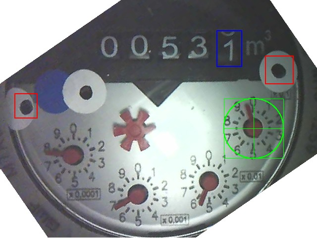
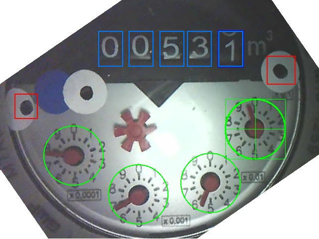
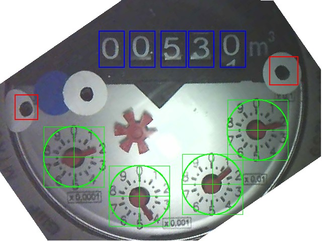

# CV node hardware run, 2026-10-13

Bench run of the CV node on an ESP32-C3 SuperMini against an ESP32-CAM running
AI-on-the-edge-device in demo mode. It checks the readiness probe and the
export flow added in `cd65404`, and how accurately readings come through on
real hardware. There is no physical meter: the camera replays the project's
12 demo photos of a water meter, whose file names are the true readings.

| | |
|---|---|
| Date | 2026-10-13, 21:29 to 21:52 (laptop time, AEST) |
| Run by | Adyn Sydee, with Claude Code driving the serial session |
| Firmware | `end_node` built from `cd65404`, flashed to the C3 over `/dev/ttyACM0` |
| End node | ESP32-C3 SuperMini, CV node (boot key `3`), channel 1, AP `AMR_Base` |
| Camera | ESP32-CAM on an ESP32-CAM-MB (`/dev/ttyUSB0`), AI-on-the-edge-device development build `fix/json-null-deref-before-flow-init` (commit `204547b+`), static IP `192.168.4.2`, `Demo = true`, one round per minute |
| Substation, gateway | Not connected. Every ESP-NOW send fails with `No substation beacon heard`, as expected |
| Serial capture | `c3_serial_2026-10-13.log`, every line stamped with laptop time |

## Results

| Run | Checks | Result | Log lines |
|---|---|---|---|
| R1 Cold boot, camera not yet on the AP | Node skips the request while no station has joined, declares itself ready only once the probe passes, then reads | Pass | 2 to 15 |
| R2 Camera reboots mid run | Failed requests send nothing, the node recovers without a restart once the camera answers again | Pass | 37 to 41 |
| R3 Full demo cycle | 12 images read in order and forwarded unchanged (accuracy below) | Pass, forwarding. Recognition 7/12 within ±0.012 | 41 to 112 |
| R4 Wrong `cam_flow` | Probe fails every 5 s, node never ready, nothing sent | Pass | 113 to 149 |
| R5 `cam_flow_exp` set | Probe passes, export is read and sent beside import | Pass | 150 to 190 |
| R6 Missing `cam_flow_exp` flow | Probe fails every 5 s, node never ready | Pass | 191 to 229 |
| R7 Sequence number across reboots | `seq` resumes from NVS after each reboot (32 → 33, 35 → 36), never repeats | Pass | 179 to 182, 257 to 260 |
| R8 Back to defaults | `cam_flow_exp` cleared, node ready again and reading import only | Pass | 230 to 265 |

### R1 Cold boot readiness

The camera had been running and searching for an AP. The C3 brought up
`AMR_Base`, the camera joined within 8 s, and the next probe passed:

```text
21:29:25.900  [WifiRadio] AP started
21:29:28.923  [CFG] seq = 0 (NVS)
21:29:28.923  [HttpBus] No station joined the AP yet, skipping request.
21:29:34.263  [CV] Cam answered with every configured flow, node ready.
21:29:34.667  [CV] import=0.480 export=0.000 seq=1
21:29:37.588  [Link] No substation beacon heard
21:29:37.589  [CV] ESP-NOW send failed.
```

The camera config at that point only had one digit and one dial window, hence
`0.480`. R3 onwards uses the full demo config, see [Camera setup](#camera-setup).

### R2 Camera reboot

The camera was rebooted at 21:33:16 to load the demo config. The node rode it
out with no intervention, rejecting the empty value the camera serves before
its first round:

```text
21:33:34.448  [HttpBus] GET http://192.168.4.2/json failed, HTTP status -1
21:34:04.590  [Cam HTTP Reader] Flow "main" has no value yet.
21:34:34.422  [Cam HTTP Reader] Flow "main" has no value yet.
21:35:04.550  [CV] import=530.074 export=0.000 seq=9
```

### R3 Demo cycle and accuracy

The C3 polls every 30 s and the camera finishes a round every 60 s, so each
camera value appears in two readings. One value per round, against the demo
image the camera was on (`accuracy.csv`):

| C3 time | seq | Camera value | True value | Error |
|---|---|---|---|---|
| 21:35:04 | 9 | 530.074 | 530.07325 | +0.001 |
| 21:36:04 | 11 | 530.112 | 530.12067 | −0.009 |
| 21:37:04 | 13 | 530.115 | 530.21419 | −0.099 |
| 21:38:04 | 15 | 530.478 | 530.48435 | −0.006 |
| 21:39:04 | 17 | 530.715 | 530.70265 | +0.012 |
| 21:40:04 | 19 | 531.757 | 530.95675 | +0.800 |
| 21:41:04 | 21 | 531.111 | 531.10877 | +0.002 |
| 21:42:04 | 23 | 531.151 | 531.24108 | −0.090 |
| 21:43:04 | 25 | 531.475 | 531.38301 | +0.092 |
| 21:44:04 | 27 | 531.641 | 531.63071 | +0.010 |
| 21:45:04 | 29 | 532.711 | 531.82235 | +0.889 |
| 21:46:04 | 31 | 530.071 | 530.07077 | +0.000 |

The images are taken in `files.txt` order, one per round. The first value
lines up with the second image, and the cycle wraps back to the first image
(530.07077) exactly 12 rounds later, which confirms the alignment.

- **7 of 12** are within ±0.012.
- **3 of 12** are about 0.1 out: the camera read the ×0.1 dial one division off.
- **2 of 12** are about 0.8 to 0.9 out: the last digit wheel was mid roll, and
  with the ×0.1 dial also misread, the camera picked the next whole number.

These are recognition errors in the camera. The firmware forwards exactly what
the camera reports. A snapshot of the camera at 21:36:49 shows its JSON saying
`530.11512` (`camera/json_213649.json`), and the C3 logged `530.115` for that
round at 21:37:04. The same snapshot's processed image is the "After" image
below: the demo photo for 530.21419, where the ×0.1 dial needle is just past 2
but the camera read it as 1. The
digit and dial windows were placed by hand from one frame (below) and have not
been fine tuned. Tuning them in the camera's ROI editor is the first thing to
try for better accuracy, starting with the ×0.1 dial: its window (kept from
the original config) sits about 5 px below and right of the dial's hub, and
every large error involves that dial.

### R4 to R6 Probe failures and the export flow

```text
21:47:30.817  [CFG] cam_flow = wrong (NVS)
21:47:33.841  [HttpBus] No station joined the AP yet, skipping request.
21:47:39.078  [Cam HTTP Reader] Flow "wrong" not present in response.
21:47:44.115  [Cam HTTP Reader] Flow "wrong" not present in response.
...                                                      (every 5 s, no readings)

21:48:35.506  [CFG] cam_flow_exp = main (NVS)
21:48:43.771  [CV] Cam answered with every configured flow, node ready.
21:48:54.052  [CV] import=530.115 export=530.115 seq=33

21:50:34.611  [CFG] cam_flow_exp = export (NVS)
21:50:42.873  [Cam HTTP Reader] Flow "export" not present in response.
...                                                      (every 5 s, no readings)
```

The camera only has one number, `main`, so R5 points `cam_flow_exp` at that
same number. That proves the export request, parse and payload path, with
export equal to import. It is not evidence that the camera can read a real
export register, which needs a meter showing both registers in one frame.

## Camera setup

The camera already had `Demo = true` and the 12 demo images in `/demo`, but
`config.ini` had only one digit window (`main.dig1`, the last wheel) and one
dial window (`main.ana1`, ×0.1). Its reading was the last digit plus decimals,
`1.77` instead of about 530. To compare against the true values, the config
was changed to read all five wheels and all four dials:

```diff
-main.dig1 438 62 49 71 false
+main.dig1 197 62 49 71 false
+main.dig2 258 62 49 71 false
+main.dig3 320 62 49 71 false
+main.dig4 375 62 49 71 false
+main.dig5 438 62 49 71 false
 ...
 main.ana1 452 199 120 120 false
+main.ana2 362 307 120 120 false
+main.ana3 217 330 120 120 false
+main.ana4 87 252 120 120 false
```

The original is kept as `camera/config.ini.before`, the uploaded one as
`camera/config.ini.demo`. The upload was read back and compared before the
camera was rebooted.

| Before: one digit and one dial window | Windows planned on the aligned image | After: all nine windows. Camera read 530.11512, true value 530.21419 |
|---|---|---|
|  |  |  |

## Not covered

- **Substation, gateway and MQTT.** No LoRa boards were connected, so this run
  stops at the C3. A CV reading reaching the broker still needs an end to end
  run (the ST-08 proposed for KZN-TD-01).
- **A real meter.** All readings come from the demo images.
- **A real export register.** See R5.

## Findings

1. **First reading waits for 30 s of uptime.** After the node is ready, the
   first reading only comes once `millis()` passes `poll_ms` (10 s after ready
   in R5), because `lastPoll` starts at 0. Harmless at the 30 s default.
2. **IP clash risk on the AP.** The camera's static IP, `192.168.4.2`, is also
   the first address the C3's AP hands out by DHCP. A laptop or phone that
   joins `AMR_Base` before the camera takes that address and the camera becomes
   unreachable. For this run the laptop joined with a static `192.168.4.50`.
   Moving the camera to an address outside the DHCP pool, or documenting the
   rule, would avoid it.
3. **Camera serial output is garbled** through the ESP32-CAM-MB at 115200: the
   same line repeats thousands of times. Not needed for this run, since the C3
   log shows what the camera answers, but worth knowing when debugging the
   camera.

## State left behind

- **Camera:** demo config with nine windows, as above. To undo, upload
  `camera/config.ini.before` through the camera's file server and reboot it.
- **C3:** CV node running, `cam_flow` set to `main` and `cam_flow_exp` set to
  empty in NVS (the same as the defaults), `seq` at 37.

## Evidence for KZN-TD-01

| DL | What this run shows |
|---|---|
| DL-001 | The CV node checks NVS, the AP and ESP-NOW, then probes the camera, and only declares itself ready once the probe passes (R1, R4, R6) |
| DL-006 | Import read from a test instance, with export read and sent when `cam_flow_exp` is set (R3, R5) |
| DL-007 | One reading per `poll_ms` with a rising `seq` that survives reboots (R3, R7) |
| DL-010 | The camera reads the demo meter face every round and the node forwards the value unchanged. Recognition is 7/12 within ±0.012 with untuned windows (R3) |
